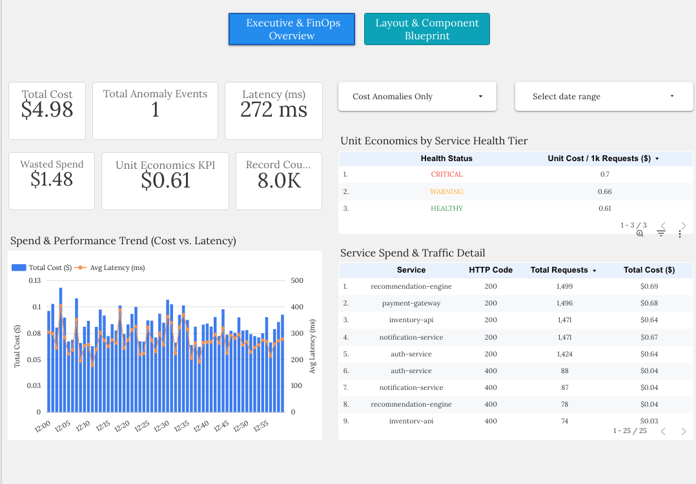
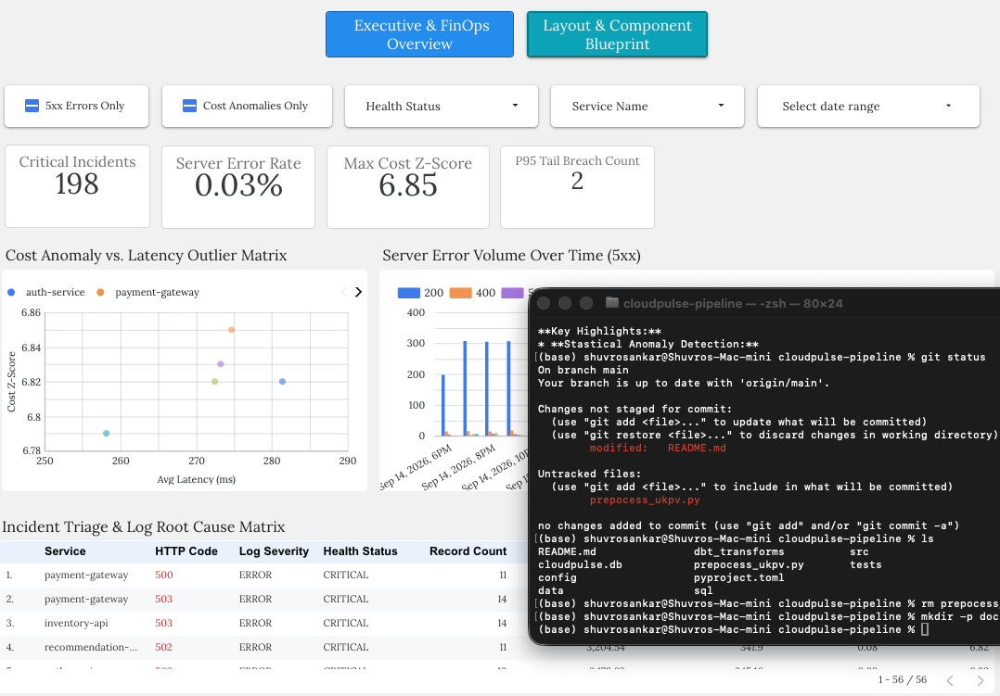

# CloudPulse: Real-Time Finops & Infrastructure Observability Pipeline

[](https://www.python.org/)
[](https://cloud.google.com/bigquery)
[](https://lookerstudio.google.com/)
[](https://opensource.org/licenses/MIT)

**CloudPulse** is an end-to-end FinOps and infrastructure observability platform designed to bridge the gap between engineering latency metrics and cloud cost anomalies.

By consuming synthetic asynchronous log streams, applying statistical anomaly detection ($Z$-score modeling and P95 latency profiling) in BigQuery, and serving dual-persona BI dashboards in Looker Studio. CloudPulse enables real-time identification of wasted cloud spend, microservice degradation, and unit economics across distributed architectures. 

---

## Executive & SRE Dashboards

### Page 1: Executive FinOps & Spend Overview
*Designed for engineering management and FinOps leaders to monitor cloud spend, unit economics and HTTP 5xx costs.*



**Key Highlights:**
* **Total Spend & Unit Economics:** `Total Cost ($)` alongside `Unit Cost per 1k Requests ($)`.
* **Wasted Spend Engine:** direct financial loss from failed server requests (HTTP 5xx).
* **Service Health Categorization:** `HEALTHY`, `WARNING`, `CRITICAL` status per request.
* **Cost vs. Latency Correlation:** dual-axis time series correlating response-time degradation with cost spikes.

### Page 2: SRE Incident Triage
*Designed for on-call engineers and SREs to isolate rogue microservices, HTTP error spikes and statistical cost anomalies.*

<!-- TODO: add docs/images/page2-sre-triage.png -->

**Key Highlights:**
* **Statistical Anomaly Detection:** rolling 50-request cost z-score (flagged at z > 3) per service.
* **P95 Latency Profiling:** per-service p95 and tail-latency flags (`is_latency_tail`).
* **Error Triage:** client (4xx) vs server (5xx) error flags to separate user mistakes from outages.

---

## Architecture



```
log_producer (async) -> asyncio.Queue -> stream_consumer -> DuckDB raw_logs
                                                              |
                         sql/views + dbt_transforms  <--------+
                                                              |
                                  Parquet export -> BigQuery -> Looker Studio
```

## Getting Started

```bash
pip install -e ".[dev]"      # or: make install
make seed                    # create cloudpulse.db with 8,000 mock logs
make analytics               # views, p95, anomalies, parquet export
make dbt                     # build + test dbt models on DuckDB
make test                    # full test suite
```

Stream live instead of seeding: `python -m src.ingestion.stream_consumer`.

## dbt models (`dbt_transforms/`)

| Model | Purpose |
|---|---|
| `stg_raw_logs` | typed, minimal view over `raw_logs` |
| `log_observability_enriched` | per-request wasted spend, unit cost, p95 tail, z-score, health status |
| `service_health_summary` | per-service roll-up for the executive page |
| `cost_anomalies` | rows with cost z-score >= 2 |

The same models run on DuckDB (`--target dev`, default) and BigQuery (`--target prod`); the few
functions that differ between the two engines live in `macros/cross_db.sql`.

## Testing

`pytest` runs unit tests for the generator, consumer, seeder, SQL analytics and BigQuery exporter
(mocked), plus an integration test that builds the dbt project and checks it matches the hand-written
DuckDB view. Use `make test-fast` to skip the dbt integration tests.

## License
MIT
